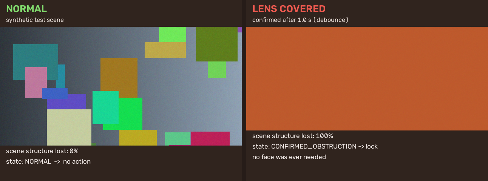
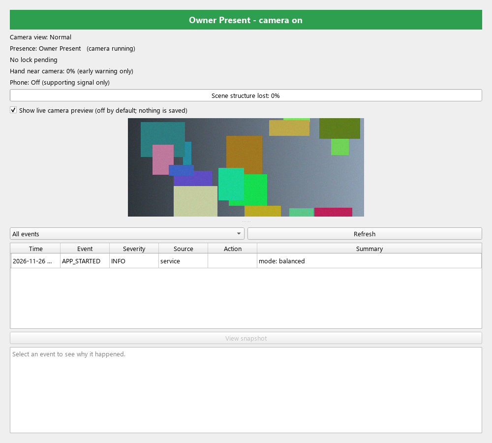
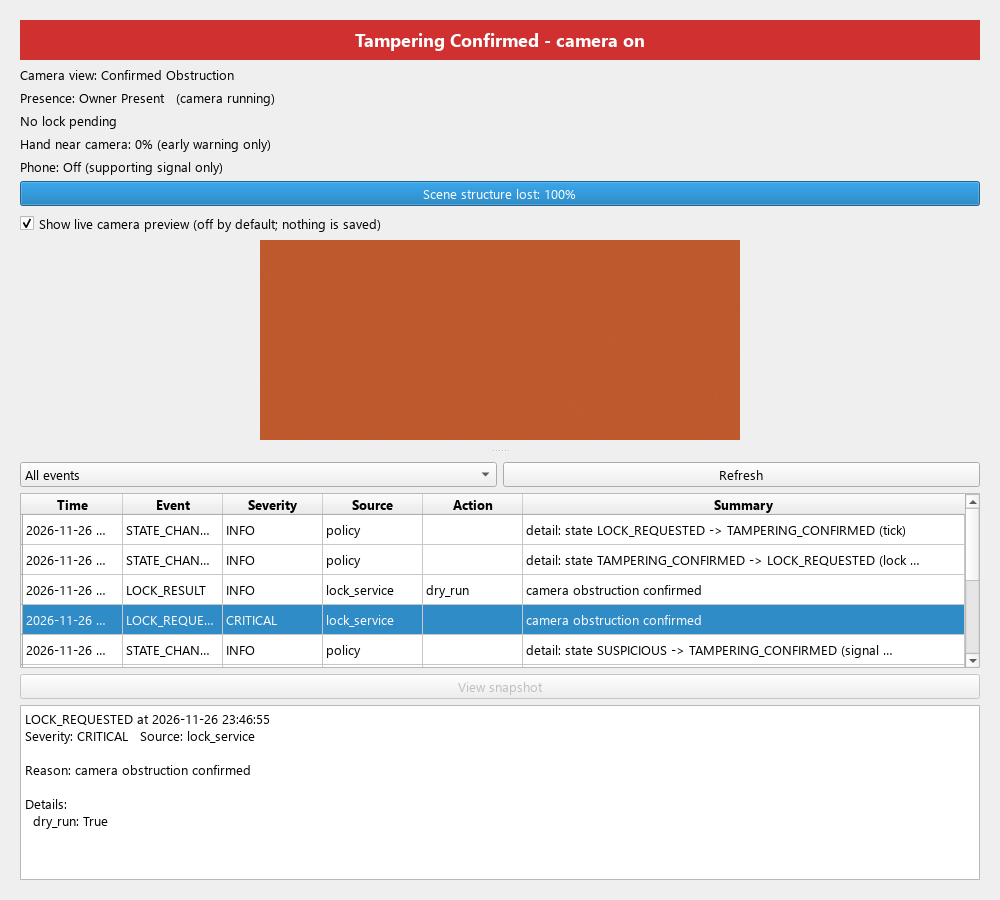
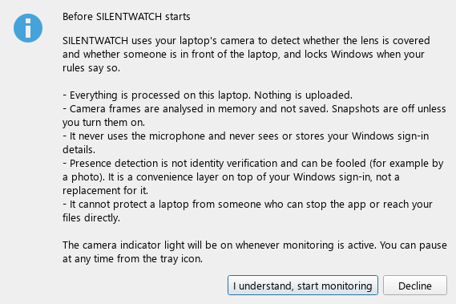
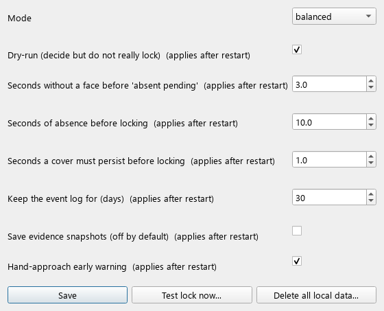
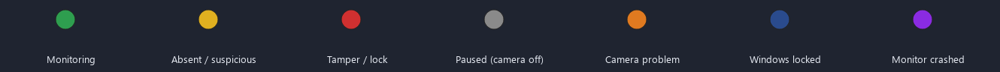
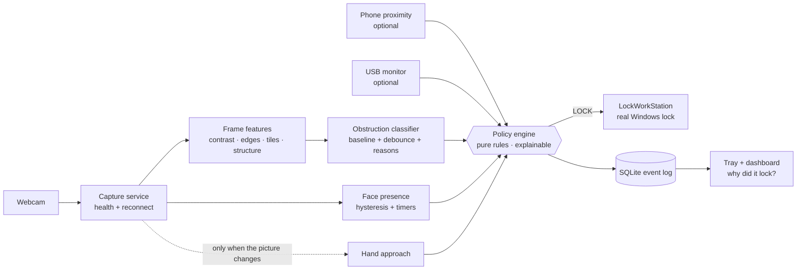

<div align="center">

# 🛡️ SILENTWATCH

### Your laptop locks itself when someone covers its camera or you walk away.
**Local-first · Windows 11 · no cloud · no network code · explains every decision**




<sub>Left: a normal scene. Right: the lens is covered, no face ever appeared, and the detector confirms an obstruction after its 1-second debounce. Both frames are **synthetic test scenes**, not photos of a real room.</sub>

</div>

---

## ✨ What it does

SILENTWATCH watches your webcam **on the laptop itself** and locks the *real* Windows session (the normal lock screen, via `LockWorkStation`) when something looks wrong.

| 🎯 Situation | 🔍 How it knows | 🔒 Result |
|---|---|---|
| Someone **covers the camera** (hand, finger, cloth, paper, shutter) | The scene's structure (contrast, edges, tiles) collapses compared with your calibrated baseline, and stays that way. **No face needed** | Lock |
| You **walk away** and stay away | No face for a few seconds, then for your configured timeout (default 10 s) | Lock |
| Camera is **disabled or unplugged** while you are away | Camera lost + owner absent | Lock |
| **USB storage** plugged in while you are away *(optional)* | Volume arrival with USB bus type | Lock |
| Your **phone is gone too** *(optional)* | Phone missing + absence pending | Locks sooner |
| A **hand rushes toward the lens** *(optional)* | Hand model, only woken when the picture changes | Warning, or lock sooner if the lens is also being covered |

### 🧠 What it deliberately does *not* do

Lock on **darkness**, a **frozen camera feed**, a **missing phone** or a **nearby hand** *alone*. A dark room with screen glow, a driver hiccup or a Bluetooth dropout are logged and warned about, never treated as an attack.

---

## 📸 Screenshots

> Rendered by [`scripts/make_screenshots.py`](scripts/make_screenshots.py) from the real UI code, driven by **synthetic scenes** (no camera, no personal images).

<table>
<tr>
<td width="50%"><b>Monitoring</b> – live preview is opt-in, off by default, nothing saved<br></td>
<td width="50%"><b>Lock decided</b> – every lock has a "why" with the evidence behind it<br></td>
</tr>
</table>

<table>
<tr>
<td width="34%"><b>Honest consent screen</b> before the camera ever starts<br></td>
<td width="33%"><b>Settings</b> – validated inline, delete-all-data, test lock<br></td>
</tr>
</table>

<b>Tray indicator</b> – always visible while the camera is in use



---

## 🧩 How it works



- **Calibrated, not guessed.** On first start it learns what "normal" looks like for *your* camera in *your* room (numbers only, no images stored).
- **Explainable.** Rules, not a black box. Each lock records the evidence, e.g. `contrast 0.04x baseline · edges 0.00x baseline · 16/16 tiles flat`.
- **Safe by construction.** The policy package has no I/O and an injected clock, so every scenario is unit-tested deterministically. The real lock is requested *before* any database write, so a locked or full disk can never delay it.

---

## 🚀 Quick start

```powershell
git clone https://github.com/shailkamtikar/silentwatch.git
cd silentwatch
py -3.12 -m venv .venv
.\.venv\Scripts\Activate.ps1
pip install -e . -r requirements-dev.txt -r requirements.txt
.\scripts\download_models.ps1        # face + hand models, SHA-256 verified
python -m pytest -q                  # 268 tests
```

```powershell
python -m silentwatch --headless          # console, DRY-RUN: logs decisions, locks nothing
python -m silentwatch                     # tray app (first run shows the consent screen)
python -m silentwatch --live              # REALLY locks Windows. Save your work first!
python -m silentwatch.tools.calibrate     # re-learn "normal" for this room
```

📖 **Step-by-step guide without any tooling: [HOW_TO_RUN.md](HOW_TO_RUN.md)**

> It is a desktop app, not a web server: you use it through the **tray icon** and the **dashboard** window.

---

## 🔐 Privacy & security

- 🏠 **Everything runs on your laptop.** No sockets, no HTTP client; a test enforces it, and a live run showed 0 TCP connections and 0 UDP endpoints.
- 🖼️ **Frames are analysed in memory and not saved.** Optional evidence snapshots are off by default and, when on, are encrypted with Windows DPAPI and auto-expire.
- 🎤 **Never uses the microphone**, never reads or stores Windows credentials, needs **no admin rights**.
- 🧹 One-click **delete all local data**, a consent screen, and a visible tray indicator whenever the camera is on.
- 🧱 Hostile or corrupt settings files fall back to safe defaults; a safety floor stops the cover-debounce from being set to "instant".

Full analysis: [`docs/threat-model.md`](docs/threat-model.md).

---

## ⚠️ Honest limitations

SILENTWATCH is a convenience layer on top of Windows sign-in, **not a guaranteed anti-theft system**.

- It can't stop someone who can already use your signed-in session to close it, or anyone with admin rights.
- A photo can be detected as a face: presence is **not identity verification**.
- A *completely* dark room with no screen glow looks the same as a black cover.
- Translucent and partial covers are known weak spots (see [`docs/obstruction-results.md`](docs/obstruction-results.md)).
- Phone proximity needs a live Bluetooth link or a small phone-side advertiser app ([`docs/decisions.md`](docs/decisions.md), D16).
- No motion/"snatch" detection: this laptop has no accelerometer.
- Detection thresholds were tuned on **synthetic scenes plus one dim room**; real-hand and real-cloth clips still need recording on your hardware.

---

## 📊 Project status

| | |
|---|---|
| ✅ Built & tested | Camera capture/health/reconnect · obstruction detector · presence · policy engine · tray app · dashboard · consent/settings/delete-all · session & sleep awareness · hand evidence · phone proximity · USB monitor · encrypted snapshots · failure-mode hardening · performance profiling |
| 🧪 Automated | **268 tests** (unit + end-to-end with a fake camera, fake faces and a fake lock; the real lock is never called by tests) |
| 👀 Verified live on a real camera | Capture, calibration, face model, full pipeline in dry-run, network silence, CPU/RAM |
| 🙋 Still needs a human | Real lock/unlock/sleep/reboot runs, covering the real lens, a real face, Bluetooth, USB, battery impact. See [`docs/manual-verification.md`](docs/manual-verification.md) |
| ⏭️ Not done | Packaging as an `.exe`, final docs and licence inventory, release (milestones 9.3 – 9.5 of the [playbook](docs/PLAYBOOK.md)) |

**Performance** (3-minute measurements on a Ryzen 7 7840HS, plugged in): ~8–9 % of *one* core (≈0.5 % of the whole CPU) and ~130–170 MB RAM. Details in [`docs/performance.md`](docs/performance.md).

---

## 🗂️ Repository layout

```text
src/silentwatch/
├── camera/      capture · health · features · calibration · obstruction classifier · hand · replay
├── presence/    face detection + hysteresis timers
├── policy/      pure decision engine (states, rules, modes)  ← no I/O
├── app/         service loop · tray · decision core · startup
├── ui/          dashboard · history · settings
├── windows/     real lock · session/power watcher · USB monitor
├── bluetooth/   proximity smoothing · enrollment
├── storage/     SQLite event log · retention · encrypted evidence
└── tools/       calibrate · lock_test · record_clip · evaluate · enroll_phone …
tests/           unit + integration (end-to-end scenarios, failure modes)
docs/            playbook · decisions · threat model · testing · performance · images
scripts/         audit · model download · measure · screenshots
```

## 📚 Documentation

| Doc | What's inside |
|---|---|
| [`HOW_TO_RUN.md`](HOW_TO_RUN.md) | Start, stop, troubleshoot, restore from GitHub |
| [`docs/PLAYBOOK.md`](docs/PLAYBOOK.md) | The 33-milestone build plan with tests and Git checkpoints |
| [`docs/SILENTWATCH_Knowledge_Book.md`](docs/SILENTWATCH_Knowledge_Book.md) | Requirements and design reference |
| [`docs/decisions.md`](docs/decisions.md) | Why things are the way they are, incl. problems found on real hardware |
| [`docs/threat-model.md`](docs/threat-model.md) | What it protects, and what it cannot |
| [`docs/testing.md`](docs/testing.md) · [`docs/manual-verification.md`](docs/manual-verification.md) | Test results and the checks that need a human |
| [`docs/performance.md`](docs/performance.md) | CPU/RAM measurements and their limits |

## 📄 Licence

MIT, see [`LICENSE`](LICENSE). The MediaPipe models and Python dependencies keep their own licences.
